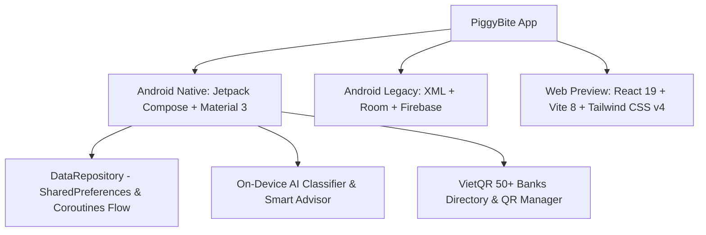

# 🐷 PiggyBite - Smart Personal Finance & Wealth Manager

<p align="center">
  
</p>

<p align="center">
  <b>Ứng dụng Quản lý Tài chính Cá nhân Thông minh, Tinh tế & Bảo mật Tối đa</b>
</p>

<p align="center">
  
  
  
  
  
  
</p>

---

## 📖 Giới thiệu (Overview)

**PiggyBite** là giải pháp quản lý tài chính cá nhân thế hệ mới dành cho người dùng Việt Nam. Ứng dụng kết hợp giữa trải nghiệm thị giác cao cấp (**Liquid Glass & Deep OLED Dark Mode**), công nghệ **AI phân loại giao dịch ngay trên thiết bị (On-Device Offline AI)**, cùng hệ sinh thái ngân hàng **VietQR** với hơn 50+ ngân hàng và ví điện tử phổ biến tại Việt Nam.

Toàn bộ ứng dụng được tối ưu theo triết lý **Privacy-First (Tôn trọng quyền riêng tư)**: Không bắt buộc mạng, không chia sẻ dữ liệu nhạy cảm, khởi đầu hoàn toàn sạch sẽ (Clean Slate) để người dùng tự do thiết lập tài khoản tài chính từ đầu.

---

## ✨ Tính năng Nổi bật (Core Features)

### 🏦 1. Quản lý Tài khoản & Ngân hàng Việt Nam (VietQR Integration)
- **Tích hợp hơn 50+ Ngân hàng & Ví điện tử**: Vietcombank, MB Bank, Techcombank, ACB, VietinBank, VPBank, TPBank, BIDV, MoMo, ZaloPay, ShopeePay...
- **Logo ngân hàng chính thức**: Nhận diện tức thì qua mã ngân hàng VietQR chính thống, tự động fallback sang huy hiệu nhận diện sắc nét khi offline.
- **Mã QR Cá Nhân (My VietQR)**: Lưu trữ ảnh mã QR nhận tiền vĩnh viễn trên máy cho từng tài khoản, hiển thị tức thì không cần kết nối mạng.
- **Tính toán Tổng tài sản**: Tự động tổng hợp số dư thời gian thực và trực quan hóa tỷ trọng phân bổ dòng tiền giữa các tài khoản.

### 🤖 2. Trí tuệ Nhân tạo Trên Thiết bị (Offline AI Engine)
- **Phân loại giao dịch tự động**: Nhận diện chính xác danh mục thu nhập (*Lương, Thưởng, Bán hàng, Tiền lãi...*) và chi tiêu (*Ăn uống, Cà phê, Mua sắm, Di chuyển, Hóa đơn điện nước, Y tế, Giáo dục...*) bằng bộ quy tắc phân tích ngôn ngữ tự nhiên tiếng Việt.
- **Tự học và cá nhân hóa**: Càng sử dụng lâu, AI càng thích ứng chính xác với thói quen và cách ghi chép của người dùng.
- **AI Financial Advisor & Quy tắc 50/30/20**:
  - Tự động phát hiện các khoản chi cố định định kỳ hàng tháng (*Tiền thuê nhà, Gói cước internet, Phí bảo hiểm...*).
  - Tự động tính toán dòng tiền ròng tích lũy (Thu nhập ròng = Tổng thu − Tổng chi).
  - Đưa ra khuyến nghị phân bổ ngân sách thông minh: **50% Nhu cầu thiết yếu**, **30% Chi tiêu linh hoạt**, và **20% Tích lũy & Đầu tư**.

### 🌙 3. Chế độ Tối Chuyên Sâu (Deep OLED Dark Mode)
- **Tối ưu hóa thị giác ban đêm**: Sử dụng bảng màu nền đen/navy chiều sâu (`#0B0F19`, `#172033`) giúp tiết kiệm pin màn hình OLED và bảo vệ mắt.
- **Màu sắc chỉ số êm dịu**: Màu đỏ chi tiêu và màu xanh thu nhập được tinh chỉnh giảm độ chói nhưng vẫn giữ độ tương phản chuẩn WCAG AAA.
- **Chuyển đổi giao diện tức thì**: Hỗ trợ chuyển đổi mượt mà giữa Chế độ Sáng (Liquid Sky Blue) và Chế độ Tối (Dark Navy Glow).

### 🔒 4. Quyền riêng tư & Thiết lập Tinh gọn (Privacy & Clean Slate)
- **Ẩn số dư 1 chạm**: Chế độ ẩn nhanh số dư nhạy cảm (`•••••• đ`) khi sử dụng ở nơi công cộng hoặc chụp ảnh màn hình.
- **Khởi đầu hoàn toàn sạch sẽ (Clean Slate)**: Không chèn dữ liệu ảo/dữ liệu mẫu; ứng dụng bắt đầu với 0 đ số dư và 0 giao dịch để bạn làm chủ hoàn toàn dữ liệu của mình.
- **Lưu trữ Cục bộ (Local-First)**: Mọi dữ liệu về tài khoản, số dư, danh mục và giao dịch được mã hóa và lưu trữ an toàn trong bộ nhớ nội bộ của máy.

---

## 🛠 Kiến trúc Công nghệ (Tech Stack)



| Thành phần | Công nghệ sử dụng |
| :--- | :--- |
| **Giao diện chính (Native)** | Jetpack Compose, Material Design 3, Coil Compose, Accompanist |
| **Ngôn ngữ** | Kotlin 2.0+ (100% Kotlin Coroutines & StateFlow) |
| **Lưu trữ & Dữ liệu** | Room Database / Local Encrypted Storage / SharedPreferences |
| **Xử lý AI & OCR** | Google ML Kit Text Recognition + On-device Rule-based Engine |
| **Quản lý QR** | ZXing Core + VietQR Standard Schema |
| **Web Preview & Tooling** | Vite 8, React 19, Tailwind CSS v4, TypeScript 5.7 |

---

## 📂 Cấu trúc Thư mục Dự án (Project Structure)

```
PiggyBite-main/
├── android/                         # [Chính] Mã nguồn Android Jetpack Compose Native
│   ├── app/src/main/java/com/money/app/
│   │   ├── data/                    # DataRepository, SharedPreferences Flow
│   │   ├── model/                   # Bank, BankAccount, Transaction models
│   │   ├── service/                 # On-device AI Classifiers & Smart Finance Advisor
│   │   └── ui/
│   │       ├── components/          # WalletSummaryCard, TransactionList, BankLogoView...
│   │       ├── dialogs/             # AddAccountDialog, MyQrDialog, QrPaymentDialog...
│   │       ├── screens/             # HomeScreen, WalletScreen, AnalyticsScreen...
│   │       └── theme/               # Theme, Deep Dark Mode Color Tokens & Typography
│   └── build.gradle.kts
├── app/                             # Mã nguồn Android Classic (XML Views + Firebase + Room)
├── src/                             # Giao diện Web / Figma Make React Component
├── APK/                             # Thư mục lưu trữ file cài đặt APK đã đóng gói
│   ├── PiggyBite.apk
│   └── PiggyBite-Kotlin.apk
└── README.md
```

---

## 🚀 Cài đặt & Trải nghiệm (Installation)

### 📲 Cách 1: Tải file APK trực tiếp (Khuyên dùng)
Bạn có thể tải trực tiếp file APK đã biên dịch sẵn trong thư mục [`APK/PiggyBite.apk`](file:///c:/VisualStudio/PiggyBite-main/APK/PiggyBite.apk) và cài đặt trực tiếp lên điện thoại Android (Android 7.0 trở lên).

### 💻 Cách 2: Tự biên dịch từ mã nguồn (Build from Source)
1. **Yêu cầu hệ thống**:
   - Android Studio Ladybug / Jellyfish hoặc mới hơn.
   - JDK 17 hoặc JDK 21 (khuyên dùng JBR kèm trong Android Studio).
   - Thiết bị chạy Android 7.0 (API Level 24) trở lên.

2. **Các bước thực hiện**:
   ```bash
   # 1. Clone repository
   git clone https://github.com/vinh0407/PiggyBite.git
   cd PiggyBite

   # 2. Chuyển vào thư mục android
   cd android

   # 3. Biên dịch bản Debug APK
   ./gradlew assembleDebug
   ```
   File APK đầu ra sẽ nằm tại: `android/app/build/outputs/apk/debug/app-debug.apk`.

---

## 🔒 Bản quyền & Đóng góp (License & Contribution)

Dự án được phát triển và duy trì bởi **[Ưng Đỗ Thế Vinh (vinh0407)](https://github.com/vinh0407)**.  
Mọi ý kiến đóng góp, báo lỗi (issue) hoặc đề xuất tính năng mới xin vui lòng mở pull request hoặc liên hệ qua GitHub Issues.

*Phát hành theo giấy phép [MIT License](LICENSE).*
